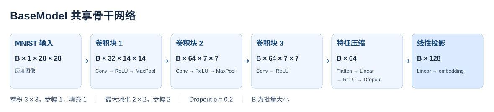

# 任务一 · BaseModel 共享骨干



本说明核对自仓库 `src/models/base_model.py`（`16dcacf`），使用默认 `hidden_dim=64`、`embedding_dim=128`、`dropout=0.2`。各张 MNIST 灰度图经相同结构编码为 128 维特征，供下游任务头使用。

| 层 | 从输入到输出 | 功能 |
| --- | --- | --- |
| Conv1 + ReLU | `[B, 1, 28, 28] → [B, 32, 28, 28]` | 提取笔画等局部特征 |
| MaxPool1 | `[B, 32, 28, 28] → [B, 32, 14, 14]` | 空间尺寸减半 |
| Conv2 + ReLU | `[B, 32, 14, 14] → [B, 64, 14, 14]` | 组合局部笔画 |
| MaxPool2 | `[B, 64, 14, 14] → [B, 64, 7, 7]` | 进一步下采样 |
| Conv3 + ReLU | `[B, 64, 7, 7] → [B, 64, 7, 7]` | 组合更高层特征 |
| Flatten | `[B, 64, 7, 7] → [B, 3136]` | 保留批维并展平特征图 |
| Linear + ReLU + Dropout | `[B, 3136] → [B, 64]` | 压缩表示，训练时用 Dropout 正则化 |
| Linear | `[B, 64] → [B, 128]` | 输出任务头使用的 embedding |

三个卷积层均使用 3×3 卷积核、步幅 1、填充 1。两个 MaxPool 层均使用 2×2 池化核、步幅 2。两层线性层之间的 Dropout 概率为 0.2。默认骨干含 264,832 个可训练参数（包含偏置）。

## 比较口径

全监督、基础弱监督、Siamese 和联合监督均使用相同的骨干架构与特征维度。这样可以控制视觉特征提取器的容量，便于比较监督信号、任务头与训练流程。不同方案各有自己的训练权重，成对输入的两个分支在同一模型内复用同一个骨干。比较结果时同时记录关系对数、绝对标签数量、随机种子和评估数据划分。

| 方法 | 从 embedding 开始的数据流 | 训练损失 |
| --- | --- | --- |
| 全监督 | 单图 → 10 类线性头 | 数字分类交叉熵 |
| 基础弱监督 | 图像对 → 共享 10 类头 → 按 `i > j` 汇总关系概率 | 关系二元交叉熵 |
| Siamese | 图像对 → 拼接两份 embedding → MLP 关系头。随后冻结骨干并训练数字分类头 | 关系二元交叉熵，随后为数字分类交叉熵 |
| 联合监督 | 图像对与少量绝对标签图像 → 共享 10 类头 | 关系二元交叉熵 + λ × 数字分类交叉熵 |

## 前向检查

在仓库根目录安装项目的 PyTorch 依赖后运行：

```powershell
python -c "import torch; from src.models.base_model import BaseModel; print(BaseModel().eval()(torch.randn(4, 1, 28, 28)).shape)"
```

预期输出为 `torch.Size([4, 128])`。

[任务一演示稿（2 页）](mission1_slides.pptx)可插入[共享 PPT](https://docs.google.com/presentation/d/19JnjjdOZlTxPAnloK0wt_idIAteMixEWlT1_je9L8dE/edit)的封面之后。
