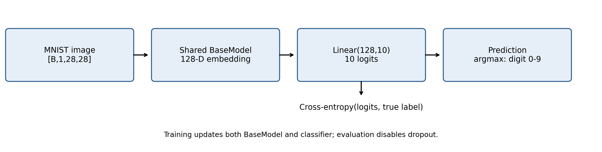
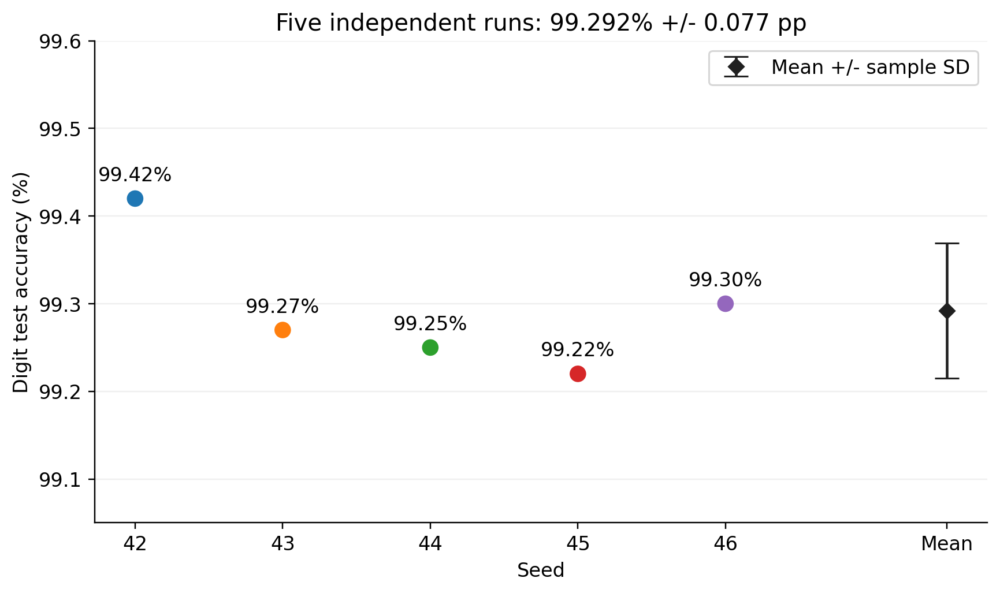
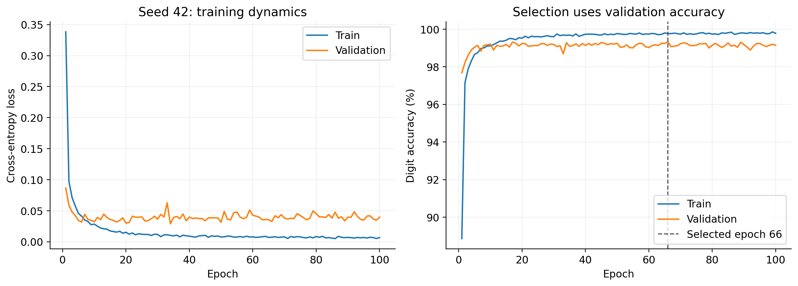
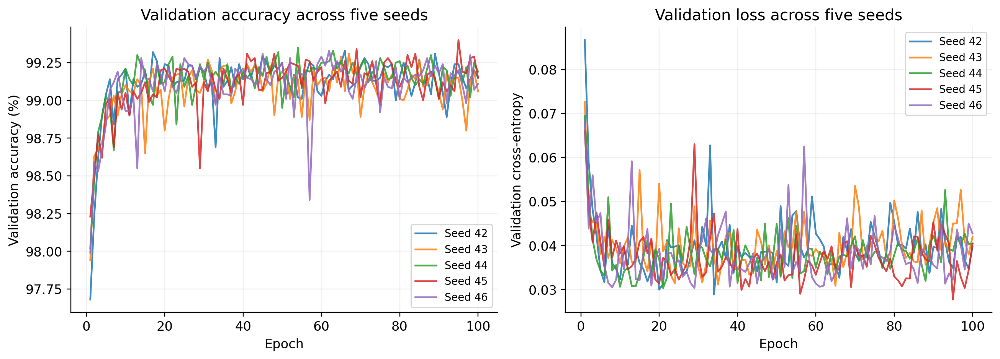
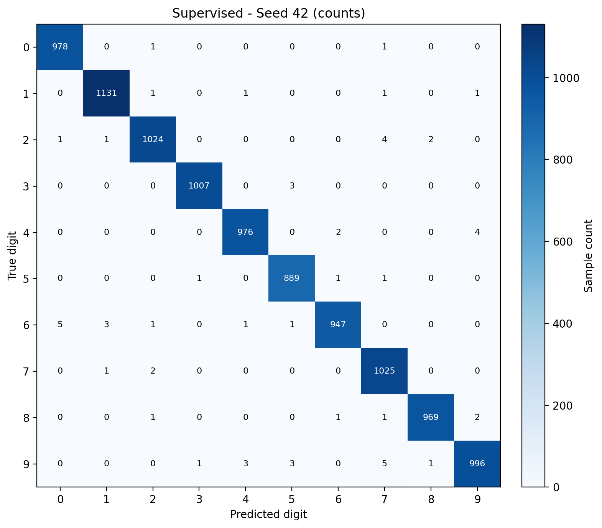
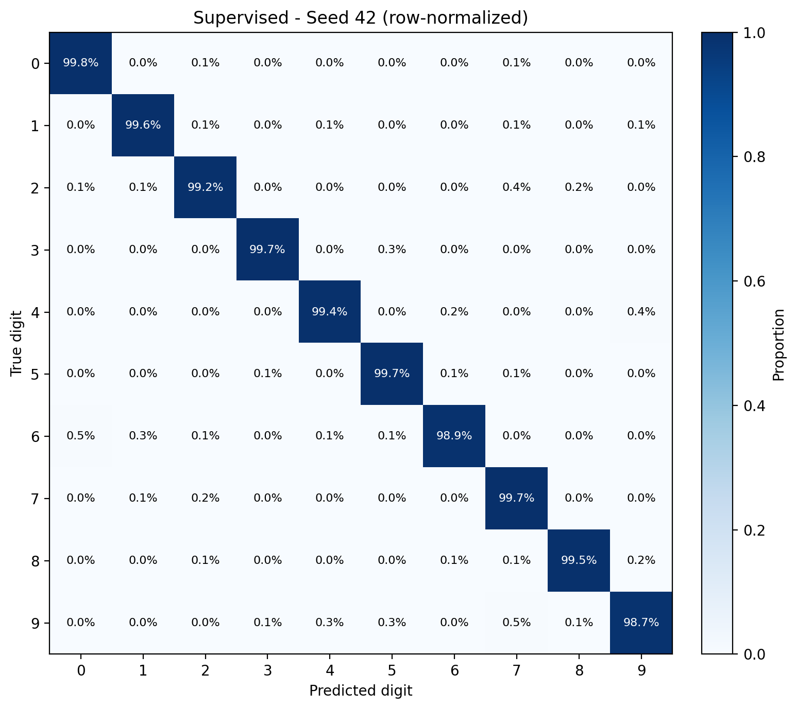
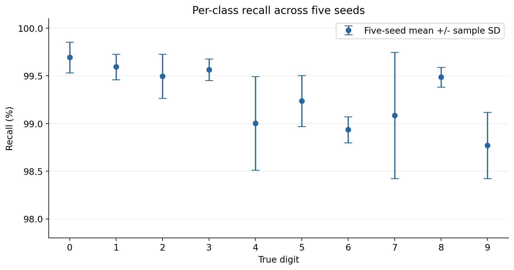
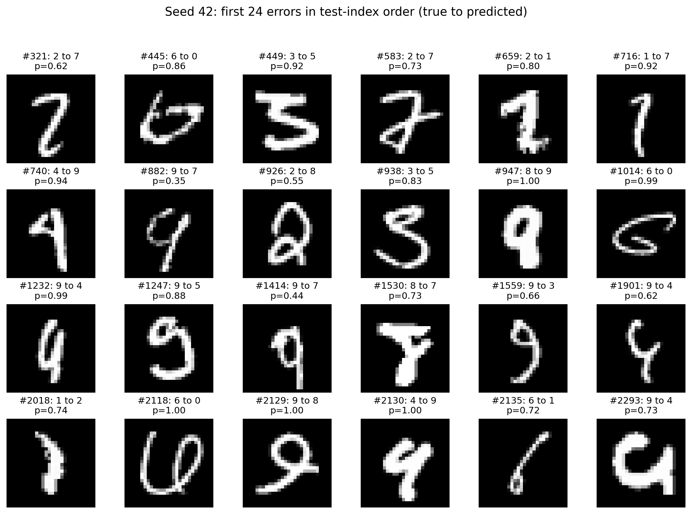
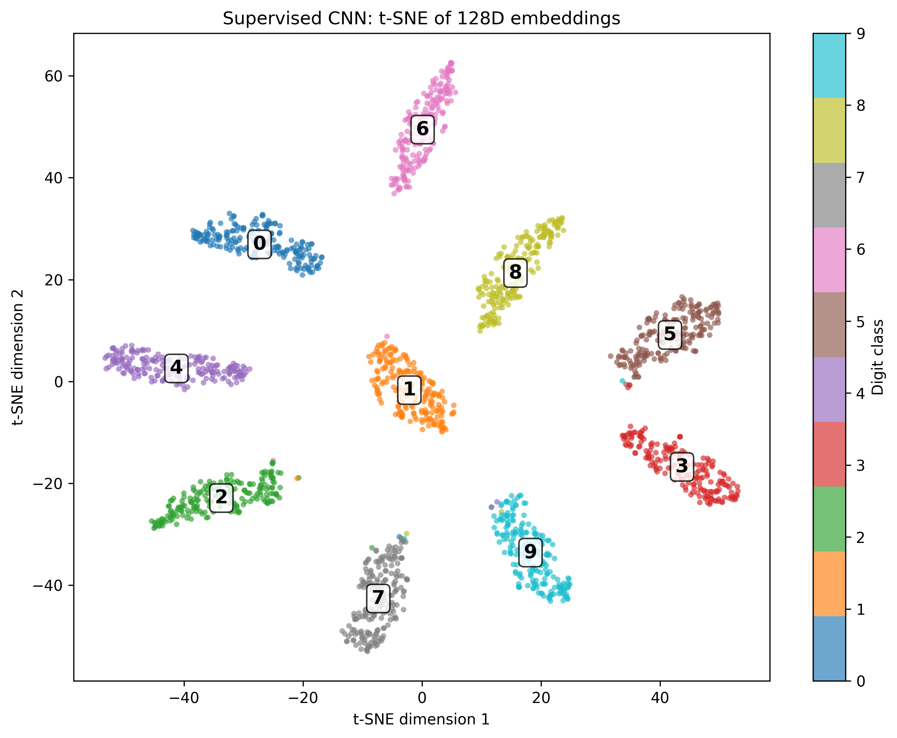
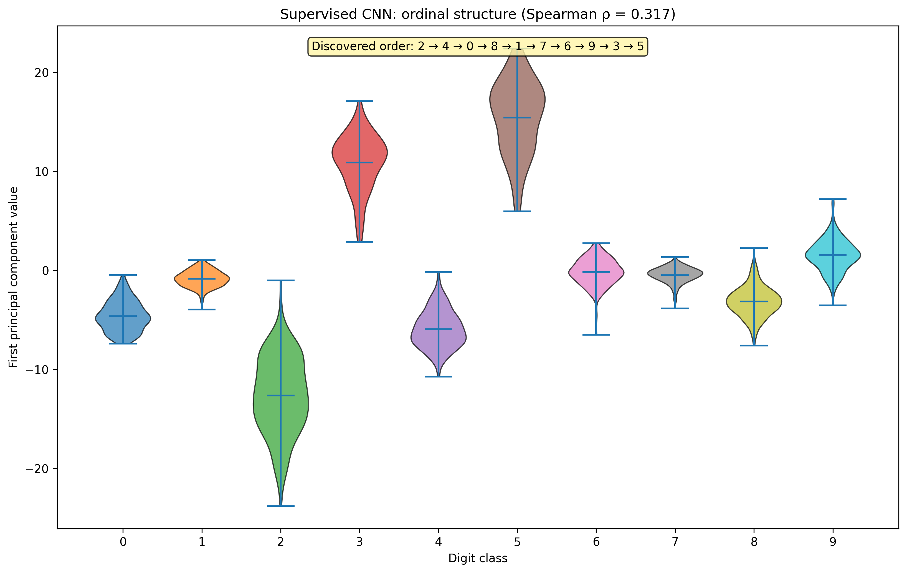

# 任务2：全监督MNIST基线实验分析报告

实验标识：`supervised_paper100_bs64_20261113_201811`  
训练日期：2026年11月13日；分析整理日期：2026年11月15日  
任务负责人标识：fh

## 摘要

本实验采用共享CNN骨干BaseModel及10类线性分类头，对MNIST开展全监督数字识别。按原报告明确记载的主要训练参数，运行100轮、batch64、Adam、学习率0.001和weight decay0.0001；按本课程规则使用seed42–46进行五次独立训练，各自依据验证准确率保存最佳模型。

五seed数字测试准确率为 **99.292% ± 0.077个百分点**，保留两位小数为 **99.29% ± 0.08%**，标准差使用ddof=1。固定seed42的测试准确率为99.42%，10000张图片中错分58张；其128维embedding在PCA第一主轴上的Spearman rho为 **0.317265**，该主轴解释 **23.09%** 的特征方差。结果表明模型具有较强的类别识别能力，而PC1上的数字顺序仅呈较弱至中等程度的单调关联。

本文参照原报告“训练动态、测试分类结果、混淆矩阵、特征分布、PCA顺序量化”的分析路径，不包含其他监督模型的实测结果，不据此宣称弱监督方法的优劣。

## 1. 原始作品与实验目的

来源是斯坦福CS231n 2025年春季课程项目 **Weakly Supervised Learning via Relational Comparisons**，作者为Sina Mollaei和Junha Lee。[斯坦福作品列表](https://cs231n.stanford.edu/2025/reports.html)和[原报告PDF](https://cs231n.stanford.edu/2025/papers/text_file_840591902-CS_231N_First_Draft.pdf)可以核实作品与方法。

任务2建立完整数字标签监督下的性能参考，供后续关系监督、少样本及联合监督方案进行组内比较。共享骨干有助于控制模型架构差异，但训练预算、模型选择、监督数量等仍需同时披露。该基线不是其他方法不可能超过的理论上界。

原报告的对应分析内容包括Figure 1模型结构、Figure 2训练曲线、Table 3分类准确率、Figure 4混淆矩阵，以及Figure 7的t-SNE和PCA顺序分析。我们保留相同类型的证据，并补充五seed统计及可供任务5作图的原始数据。

## 2. 数据、模型和训练协议

### 2.1 数据与标签

- MNIST灰度图片，输入形状为 `[B,1,28,28]`，像素转换为float并除以255。
- 从官方60000张训练图片顺序切分出50000张训练和10000张验证，保留官方10000张测试图片。
- 使用50000张训练图片的完整数字类别标签。验证标签用于checkpoint选择，测试标签用于评价，未用于训练梯度。
- 本任务没有关系对训练，也没有1-shot/3-shot设置。监督成本比较应同时披露验证标签的使用，不能把50000个训练标签解释为项目唯一使用的标签。

### 2.2 模型与损失

BaseModel包含三层3×3卷积，其中前两层后接MaxPool，卷积通道为1→32→64→64；Flatten后经3136→64全连接层、ReLU、Dropout(0.2)，再生成128维embedding。分类头为Linear(128,10)。训练通过交叉熵同时更新骨干和分类头，测试取logits最大值对应的数字。

图1：输入、共享骨干、分类头、推理输出及交叉熵。此处“共享”指各任务采用相同骨干架构，不表示任务2加载了其他同学的训练权重。

### 2.3 实际设置

| 项目 | 本次设置 |
|---|---|
| epoch | 每seed 100轮 |
| batch size | 64 |
| 优化器 | Adam，默认betas=(0.9,0.999)、eps=1e-8 |
| 学习率 / weight decay | 0.001 / 0.0001，固定学习率，无调度器 |
| seed | 42、43、44、45、46 |
| 每轮训练batch数 | ceil(50000/64)=782，最后一批16张 |
| 每seed优化器更新数 | 78200 |
| 最佳模型选择 | 验证集数字准确率最高；同分保留最先出现的轮次 |
| 测试时机 | 每seed完成100轮后，加载其最佳验证checkpoint |
| 设备 | CPU，PyTorch 2.7.0+cpu，4线程，num_workers=0 |
| 随机性设置 | 每seed固定Python/NumPy/PyTorch种子，deterministic=true |

主要超参数与原报告第4.2节一致，但软件、硬件和随机性设置未必完全相同；本次五seed汇总是课程实验补充。原报告第4.2节与Table 3的全监督准确率分别记为99.38%与99.23%，因此仅将其作为带有来源说明的文献参照。本次实测达到相近量级，不作统计显著优于/劣于原报告的判断。

## 3. 五seed分类性能与稳定性

| Seed | 最佳epoch | 最佳验证准确率 | 数字测试准确率 | 测试交叉熵 | 测试错分数 |
|---|---:|---:|---:|---:|---:|
| 42 | 66 | 99.33% | 99.42% | 0.02314 | 58 |
| 43 | 67 | 99.31% | 99.27% | 0.02746 | 73 |
| 44 | 54 | 99.35% | 99.25% | 0.03203 | 75 |
| 45 | 95 | 99.40% | 99.22% | 0.02932 | 78 |
| 46 | 62 | 99.33% | 99.30% | 0.02849 | 70 |

五seed均值为99.292%，样本标准差0.0772658个百分点，最小99.22%、最大99.42%，跨度0.20个百分点。

图2：各点是一个独立seed的最终测试准确率；黑色误差棒为五seed均值±样本标准差，不是置信区间。纵轴局部展开便于观察波动。

总准确率跨seed波动较小，说明在本固定数据划分和训练协议下结果较稳定。五次运行重复评估同一批测试图片，不能视为50000张独立测试样本，也不能仅根据均值与标准差推断在新数据分布上的置信界。

## 4. 训练曲线与checkpoint选择

图3：参照原报告Figure 2绘制固定seed42的训练/验证损失和准确率。第66轮由验证准确率选择，测试集未参与该轮次的选择。

图4：五seed均在前5～7轮首次达到99%的验证准确率，此后指标进入较高水平并伴随波动；完整100轮曲线保留实际数据，未做平滑。

| Seed | 首次验证准确率≥99%的epoch | 最佳epoch | 第100轮训练准确率 | 第100轮验证准确率 |
|---|---:|---:|---:|---:|
| 42 | 5 | 66 | 99.782% | 99.15% |
| 43 | 7 | 67 | 99.808% | 99.06% |
| 44 | 5 | 54 | 99.710% | 99.19% |
| 45 | 6 | 95 | 99.840% | 99.15% |
| 46 | 6 | 62 | 99.804% | 99.11% |

以seed42为例，训练损失从首轮约0.338下降到第100轮约0.00674；其最佳验证准确率为第66轮99.33%，第100轮为99.15%，验证损失也从第66轮约0.03265变为第100轮约0.03976。这表明训练目标继续降低，并不保证验证表现同步提高，呈现一定训练/验证差距和后期波动。应使用既定的验证checkpoint选择规则，而不是默认最后一轮最好。

训练指标在 `model.train()`、Dropout开启时累计，验证指标在 `model.eval()` 下计算，二者的评估模式不同。早期验证准确率高于训练准确率不必然是数据异常，也不能仅用一次train/val差距诊断过拟合。

## 5. 混淆矩阵与具体错分

可视化固定使用seed42，遵守课程预先规定；它同时是本次测试最高seed是结果上的巧合，不构成选择理由。其最佳checkpoint为第66轮。

图5：行是真实数字，列是预测数字。原始计数矩阵用于核对样本数，按行归一化矩阵用于比较不同类别召回率。

seed42正确9942张、错分58张，总体准确率99.42%。主要非对角项如下：

| 真实类别 | 预测类别 | 错分张数 | 占该真实类别比例 |
|---|---|---:|---:|
| 6 | 0 | 5 | 0.522% |
| 9 | 7 | 5 | 0.496% |
| 2 | 7 | 4 | 0.388% |
| 4 | 9 | 4 | 0.407% |
| 3 | 5 | 3 | 0.297% |
| 6 | 1 | 3 | 0.313% |
| 9 | 4 | 3 | 0.297% |
| 9 | 5 | 3 | 0.297% |

### 5.1 各类别表现

| 数字 | 测试样本数 | 错分数 | Recall |
|---|---:|---:|---:|
| 0 | 980 | 2 | 99.80% |
| 1 | 1135 | 4 | 99.65% |
| 2 | 1032 | 8 | 99.22% |
| 3 | 1010 | 3 | 99.70% |
| 4 | 982 | 6 | 99.39% |
| 5 | 892 | 3 | 99.66% |
| 6 | 958 | 11 | 98.85% |
| 7 | 1028 | 3 | 99.71% |
| 8 | 974 | 5 | 99.49% |
| 9 | 1009 | 13 | 98.71% |

seed42中数字9、6的召回率相对较低，但均超过98%。错误分散在若干类别对之间，没有观察到某一整个真实类别普遍被映射成另一数字的现象。

图6：每类召回率的五seed均值±样本标准差。精确数值见 `analysis_data/per_class_summary.csv`。五seed中数字9的平均召回率约98.77%，数字6约98.94%；数字7的召回率跨seed标准差约0.662个百分点，高于总体准确率标准差。总体稳定不代表每个类别同样稳定。

### 5.2 错误样本观察

图7：按官方测试索引升序展示前24张错分图片；标题给出索引、真实标签、预测标签及预测类别softmax概率。所有58张错分数据保存在 `predictions/seed42_misclassified_images.npz`，全部10000张测试预测保存在CSV中。

从样本可见，部分手写数字的笔画外观具有类间相似性，例如某些6与0的闭环结构、某些9与7的笔画。这为局部形态混淆提供定性解释，但没有对全部错误逐项归因，也没有修改官方标签。某些错分具有较高softmax分数，说明单次softmax高值仍可能预测错误；本实验未进行完整校准评估，不能据此断言整体校准优劣。

## 6. t-SNE、PCA小提琴图及顺序量化

### 6.1 采样与实现口径

使用seed42最佳checkpoint的BaseModel，固定分析seed42，从官方测试集每类抽取200张，共2000张图片。图片索引与标签、128维embedding、t-SNE坐标和PC1投影均已保存。

t-SNE：二维、perplexity=30、init=pca、learning_rate=auto、max_iter=1000。PCA直接作用于128维embedding，而不是作用于二维t-SNE坐标。Spearman rho计算的是每张图片PC1投影与真实数字标签的秩相关。

PC1符号不唯一，当前脚本在raw rho<0时翻转投影，JSON同时保留raw rho与翻转标记。本次raw rho为正，未发生翻转。Discovered order按十类平均投影值排序。

### 6.2 t-SNE类别可分性

图8：大部分数字形成较清晰的局部类别簇，存在少量离群或混杂点。这与较高的分类性能相符。簇在二维平面上的方位、距离及路径不能直接解释为数字大小顺序，图中也没有展示所有10000张测试图片。

### 6.3 PCA主轴上的数字顺序

图9：每类200张图片的PC1投影分布，横线表示均值；图中文字给出按类别平均投影排序的Discovered order。

| 指标 | seed42实测 |
|---|---|
| Spearman rho | 0.317264749 |
| raw rho | 0.317264749 |
| nominal p-value | 5.24468e-48 |
| PC1解释方差比例 | 23.0887% |
| Discovered order | 2 → 4 → 0 → 8 → 1 → 7 → 6 → 9 → 3 → 5 |

该顺序与0到9的自然数字顺序不同，投影分布也存在重叠。rho≈0.317说明PC1上的单调关联有限，远非接近完美的排序。p值很小并不意味着效果很强；它是样本数和检验假设下的统计量。本次分析具有测试集分层抽样、PC1方向处理等条件，p值不用于模型优劣或泛化能力的判断。

**解释：交叉熵目标鼓励正确分类，不显式惩罚数字顺序颠倒。因此，高数字识别率和有限的PC1序关系可以同时出现。** PC1只解释约23.09%的方差，不能据此断言剩余表示没有任何数值、序关系或语义信息，也不能从t-SNE图推断全局几何或其他模型的泛化优势。

## 7. 与原报告分析方法的关系及局限

本报告复用了原研究的分析问题与证据类型，并匹配其明确的100轮、batch64、学习率和weight decay。五seed重复、固定seed42、每类200张平衡抽样及导出JSON/CSV是本课程的明确规则。

原始公开embedding脚本采用前20个batch、batch64的测试图片，未做每类200张平衡抽样；其rho直接采用有符号PC1相关。抽样、PC1方向、模型权重与软件版本可能影响数值和图形，所以本次不以复现某个具体rho或Discovered order为成功标准。原报告公开代码默认epoch与文字记载亦存在差别，应以本报告保存的实际配置为准。

本实验的主要边界是：数据集为MNIST；五seed使用同一测试集；embedding只分析一个预定seed；未与任务3～5的实测数据配对比较；未测量真实人工标注成本；相同主要超参数不等于完全相同的实验环境。报告不将模型可分性、PC1顺序相关性和跨任务泛化能力混为同一结论。

## 8. 给任务5的可比数据与使用方式

`task5_handoff/` 提供一行模型汇总、五seed明细、50行各类别指标、2000个固定测试索引和seed42的embedding指标。准确率均为百分数，标准差为百分点；不适用的关系准确率、关系对数和shot数留空。

对照应统一数字测试集、seed列表、预处理和骨干架构，并同时披露每种方案的优化步数、关系对数、绝对标签数量、分类头训练预算及是否冻结骨干。任务2的训练标签数为50000；其他任务的50k/500k是关系对规模，单位不同。关系准确率与数字分类准确率应分列。

本条全监督基线可在不同关系对规模的比较图中作为共同参考线，不需要为关系任务的每个规模虚构一次全监督运行。embedding对照应采用本报告导出的同一批图片索引，避免改变样本造成视觉差异。

## 9. 结论

在本次100轮、batch64的训练协议下，全监督MNIST模型取得99.29% ± 0.08%的五seed数字测试准确率，提供稳定的完整标签参考。固定seed42的混淆矩阵仍有58张错分；特征可视化显示清晰类别分组，但PC1上的数字大小顺序关联有限。后续任务应分别比较识别性能、运行稳定性与序关系结构，结合监督成本和训练预算解释结果。

## 参考资料

1. [斯坦福CS231n 2025作品列表](https://cs231n.stanford.edu/2025/reports.html)。
2. [原始报告PDF](https://cs231n.stanford.edu/2025/papers/text_file_840591902-CS_231N_First_Draft.pdf)，重点参照第4.2、5.1、5.4节及Figures 1、2、4、7。
3. [原始训练代码](https://github.com/junhakunha/cs231n_final_project/blob/main/src/training/train_supervised.py)。
4. [原始特征分析代码](https://github.com/junhakunha/cs231n_final_project/blob/main/src/visualization/embedding_analysis.py)。
5. 本目录中的 `training_results/`、`analysis_data/`、`predictions/` 和 `figures/embedding_seed42/` 为本次实测证据。
