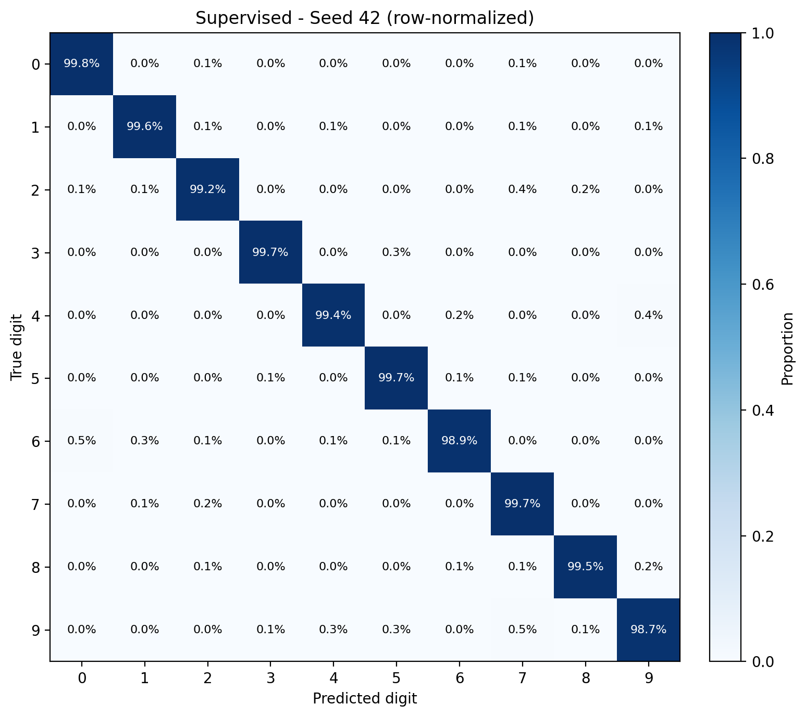
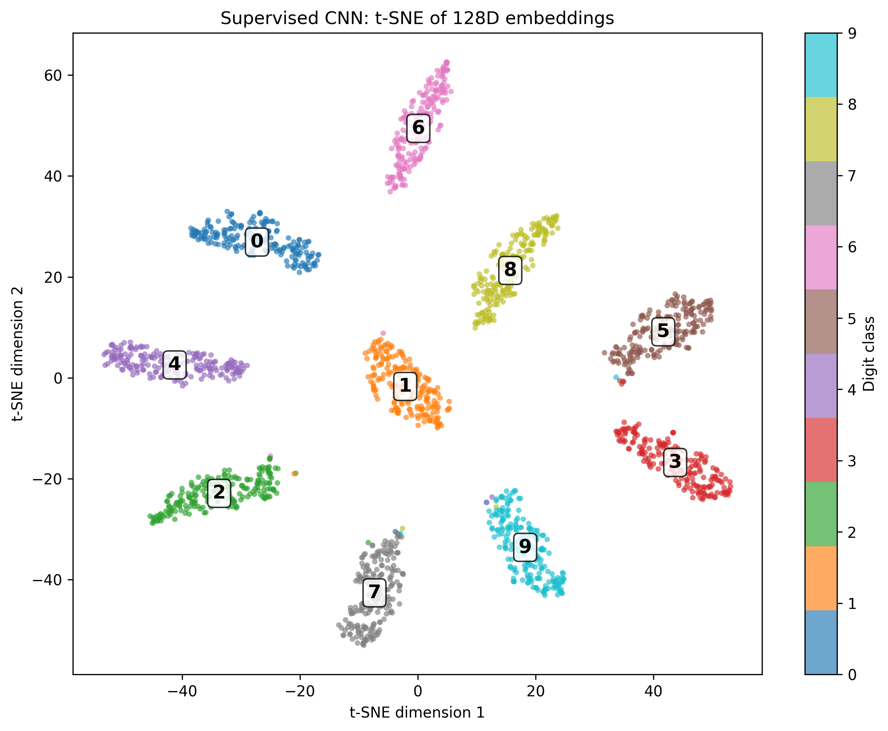
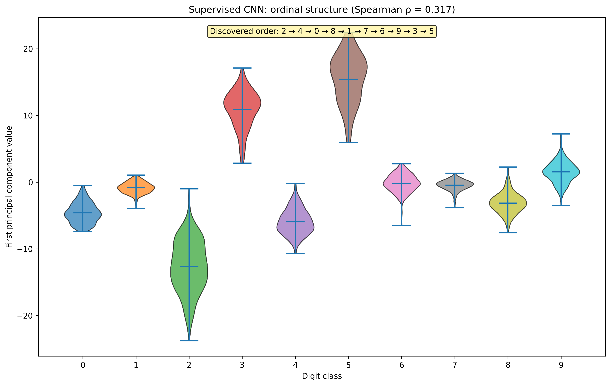

# 全监督基线：汇报内容与讲稿

对应[共享PPT第2、3页](https://docs.google.com/presentation/d/19JnjjdOZlTxPAnloK0wt_idIAteMixEWlT1_je9L8dE/edit#slide=id.h43316f9c7a0f8ff8_5_3)。2026年11月15日按面向老师的期末项目汇报调整，第一页保持不动。

## 第2页：全监督基线：训练方法与分类结果

### 页面内容

MNIST：50,000张训练、10,000张验证、10,000张测试；像素归一化至[0,1]。

3层卷积 → 128维特征 → 10类线性分类头；交叉熵同时训练骨干和分类头。

Adam；学习率0.001（固定）；weight decay=0.0001；batch size=64。

每个seed训练100轮，按最高验证准确率选择模型，再在测试集上评估。

| Seed | 最佳epoch | 测试准确率 |
|---|---:|---:|
|42|66|99.42%|
|43|67|99.27%|
|44|54|99.25%|
|45|95|99.22%|
|46|62|99.30%|

平均准确率 99.29%

五次训练的样本标准差：0.08个百分点

seed42：测试集错分58张

主要错误：6→0、9→7，各5张

后续减少数字标签时，可据此比较分类准确率与不同随机种子下的波动。

### 演讲备注

我们先用完整数字标签训练一个CNN，得到全监督基线。后面的方法会减少数字标签、加入图片间的关系标签，因此需要这组结果来衡量分类性能的变化。
MNIST官方训练集按顺序分为50000张训练、10000张验证，保留官方10000张测试图。像素除以255。模型有三层3×3卷积，通道为1→32→64→64，前两层后使用最大池化。卷积输出经过全连接层和Dropout(0.2)，得到128维特征，再接10类线性分类头。交叉熵同时更新骨干与分类头。
训练使用Adam，学习率固定为0.001，weight decay为0.0001，batch size为64；不使用学习率调度器。每个随机种子训练100轮，合计78200次参数更新。我们使用42、43、44、45、46五个seed重复训练。训练过程中只根据验证准确率选择模型，同分保留较早轮次，最后加载选出的权重进行测试。
五次测试准确率分别为99.42%、99.27%、99.25%、99.22%、99.30%。平均为99.292%，样本标准差为0.0773个百分点。结果都在99.2%以上，说明在这一固定划分下，完整标签训练的分类表现比较稳定。它是五次训练的波动，不是测试准确率的置信区间。固定展示seed42，正确9942张、错分58张，6误判成0和9误判成7各5张；从错误图片看，部分手写笔画存在相似性，但这里没有逐张确定原因。
后续实验以这组结果为参照，比较使用关系标签或少量数字标签后，准确率改变了多少，以及不同seed的波动是否增大。若其他方法采用不同的训练轮数或参数更新数，应一并说明。全监督训练用了50000个数字标签，验证标签也参与了模型选择。
实验记录：supervised_paper100_bs64_20261113_201811，mission2_fh/training_results/runs.csv、summary.json和seed42混淆矩阵。训练主要参数参考Sina Mollaei、Junha Lee的CS231n 2025课程报告Weakly Supervised Learning via Relational Comparisons，第4.2节：https://cs231n.stanford.edu/2025/papers/text_file_840591902-CS_231N_First_Draft.pdf 。本页报告的是我们保存的实验结果。

## 第3页：特征分析：分类能力与数字顺序

### 页面内容

提取seed42的128维特征，每类抽取200张测试图片，共2,000张。

t-SNE：各数字大体形成独立的簇

PCA：第一主轴上的数字顺序较弱

PC1与数字标签的Spearman ρ = 0.317；解释方差23.09%

Discovered order：2 → 4 → 0 → 8 → 1 → 7 → 6 → 9 → 3 → 5

交叉熵只要求分对类别，没有直接约束数字大小，因此高准确率不保证PC1按0～9排列。

后续在相同图片上比较准确率与ρ，观察关系监督能否用较少数字标签保留识别能力、改善顺序。

### 演讲备注

除了分类准确率，我们还检查了模型提取的特征。使用seed42按验证集选出的最佳模型，从测试集每类抽200张，共2000张，提取128维特征。后续方法使用同一批测试图片，便于比较。
左侧t-SNE中，大多数数字分成了相对清楚的簇，与较高的分类准确率相符。不过簇在二维图中的方位和距离不能直接当作数字大小。t-SNE仅用于观察局部分布。
右侧PCA小提琴图是在原始128维特征上计算第一主成分，而不是对t-SNE结果再降维。PC1与真实数字标签的Spearman rho为0.317，说明这一主轴与数字大小有一定单调关联，但不强。按各类平均PC1投影得到的顺序为2、4、0、8、1、7、6、9、3、5，与0至9的自然顺序不同。这说明分类准确率高并不意味着PC1上也形成了自然数字顺序。交叉熵优化的是类别预测，没有直接要求特征按数字大小排列。
PC1只解释23.09%的方差，所以不能把这个结果推广为整个特征空间都缺少顺序信息。这里的rho也仅来自seed42，不是五个seed的均值。PCA方向本身不唯一，代码会根据raw rho符号处理方向；本次raw rho为正，没有翻转。t-SNE使用perplexity30、init=pca、learning_rate=auto、max_iter1000、random_state42。
接下来的关系监督与少样本实验，可以同时回答两个问题：减少数字标签后是否还能接近全监督的分类准确率；大小关系监督是否改善了PC1上的数字顺序。比较时统一数据划分、预处理、骨干与测试样本，另外记录训练更新数、关系对数、数字标签数及验证标签使用。关系预测准确率与数字分类准确率需要分开报告。关系对的50k或500k与全监督图片数的单位不同。
数据与方法来源：mission2_fh/figures/embedding_seed42/embeddings.npz、embedding_metrics.json及分析报告；分析参照原CS231n报告Figure7：https://cs231n.stanford.edu/2025/papers/text_file_840591902-CS_231N_First_Draft.pdf 。
