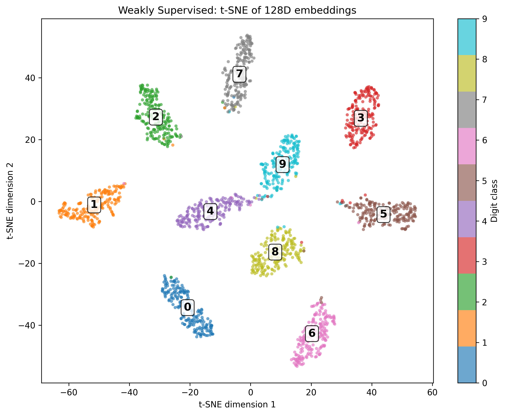
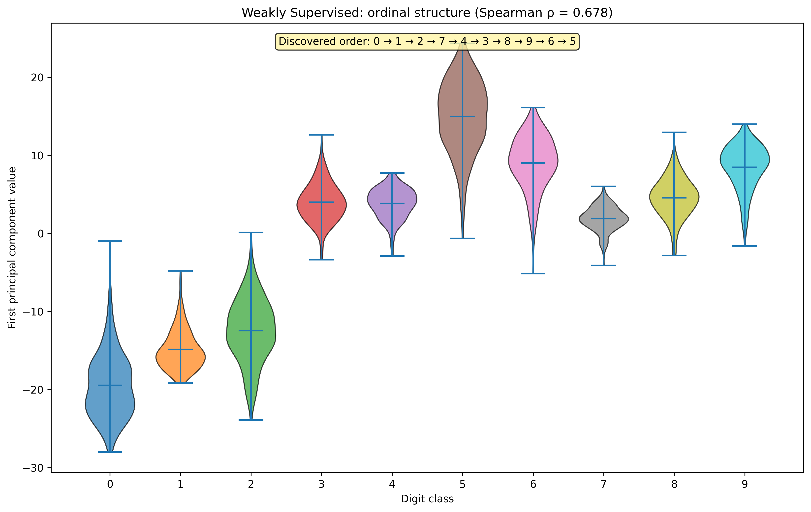
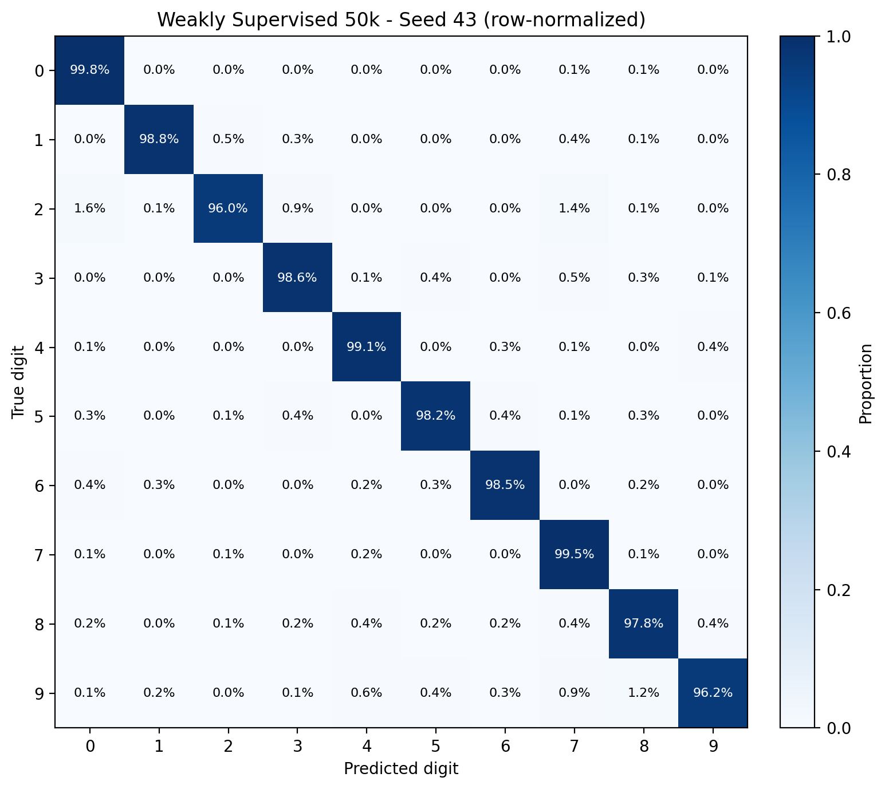
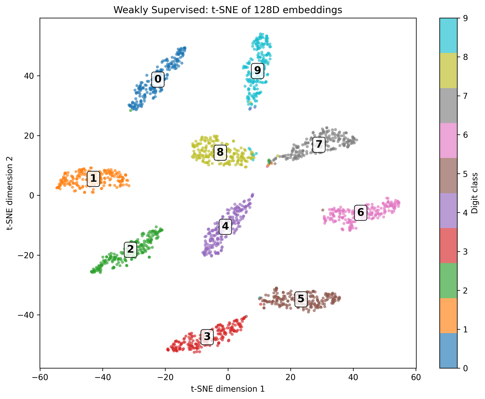
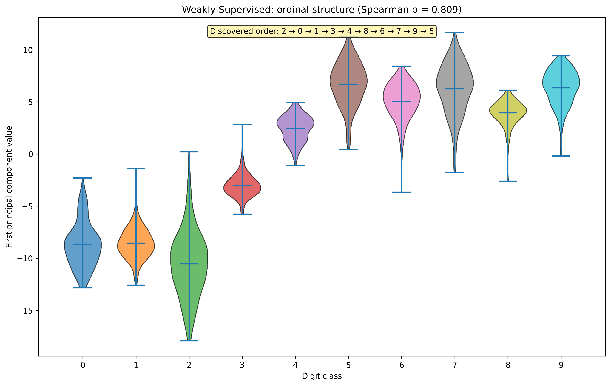
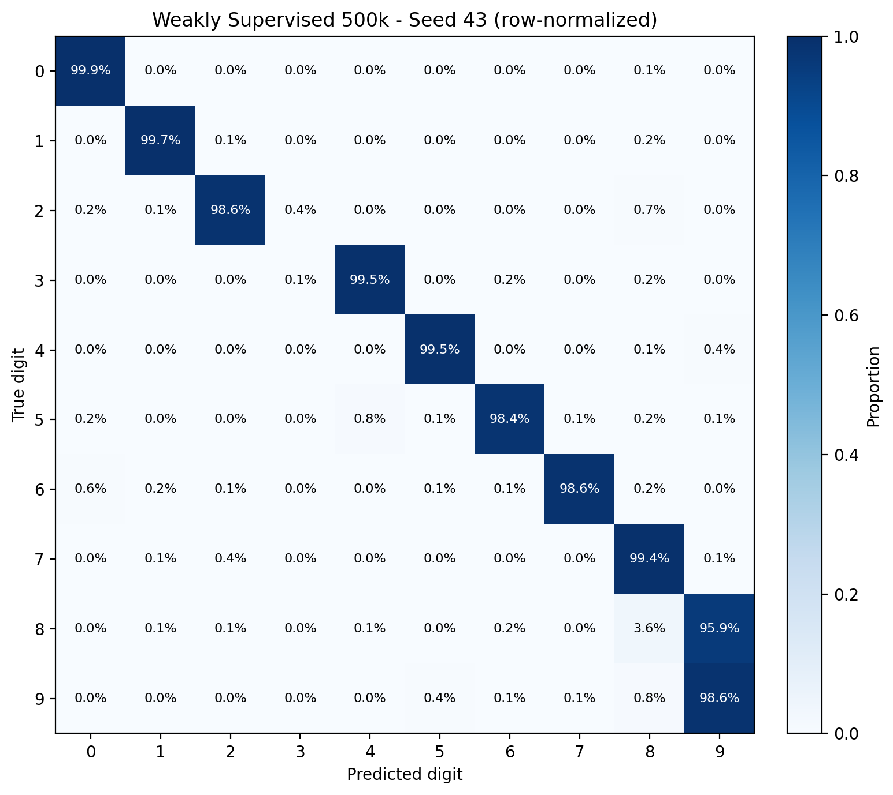

# seed 43

## 50k

- 关系测试准确率：**98.935%**
- 数字测试准确率：**98.26%**
- 最佳 epoch：4
- 错位（真实类→主预测类）：无，恒等映射
- Spearman ρ：0.6778
- Discovered order：0 → 1 → 2 → 7 → 4 → 3 → 8 → 9 → 6 → 5

文件：`metrics_50k.json`、`history_50k.csv`、`checkpoint_50k.pth`、`confusion_matrix_50k.csv`、`confusion_matrix_50k/`、`embedding_50k/`

## 500k

- 关系测试准确率：**98.360%**
- 数字测试准确率：**41.62%**
- 最佳 epoch：5
- 错位（真实类→主预测类）：3→4, 4→5, 5→6, 6→7, 7→8, 8→9
- Spearman ρ：0.8093
- Discovered order：2 → 0 → 1 → 3 → 4 → 8 → 6 → 7 → 9 → 5

文件：`metrics_500k.json`、`history_500k.csv`、`checkpoint_500k.pth`、`confusion_matrix_500k.csv`、`confusion_matrix_500k/`、`embedding_500k/`

## 图

