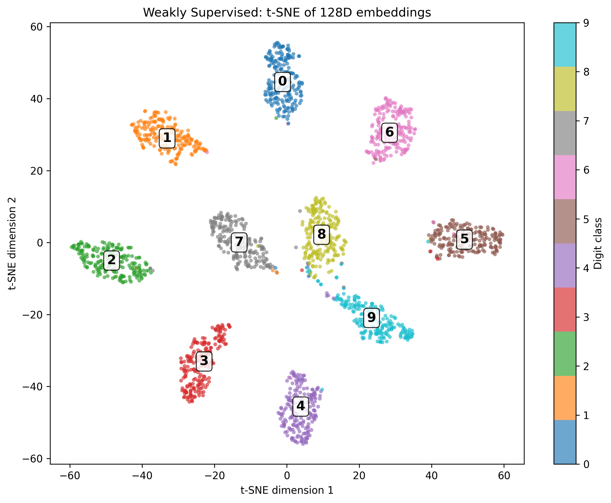
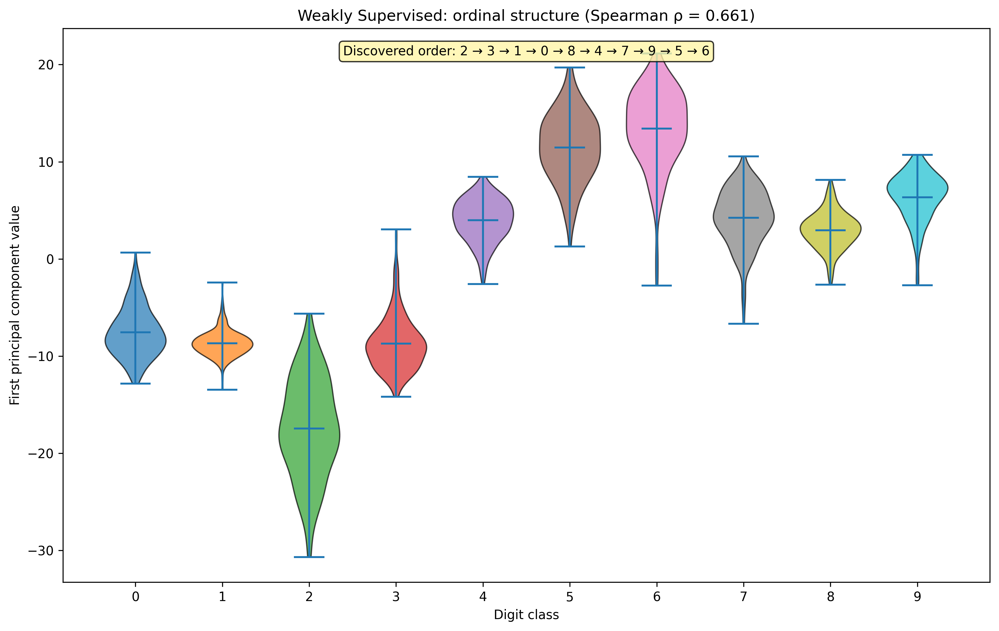
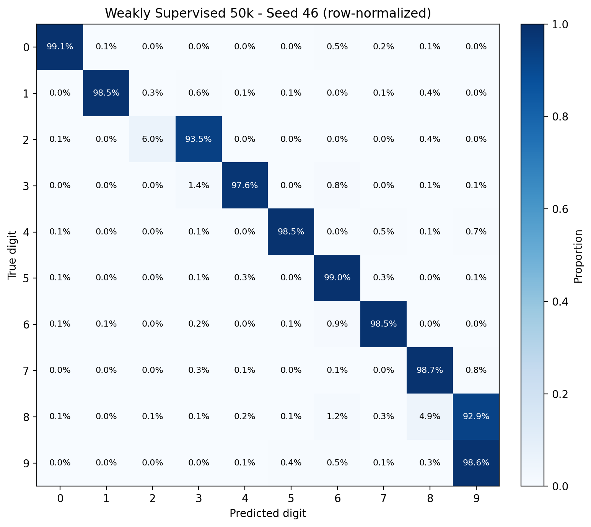
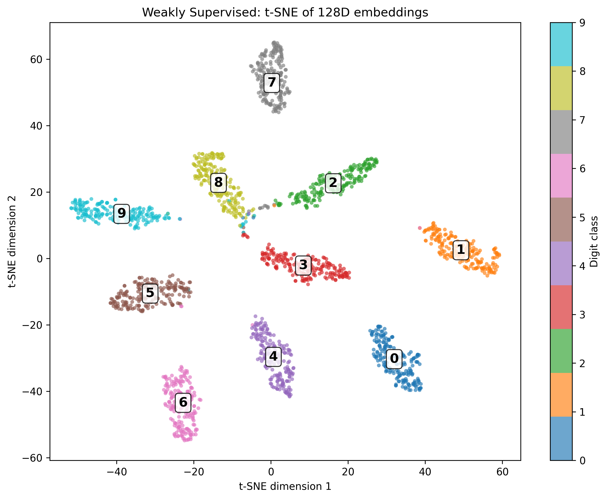
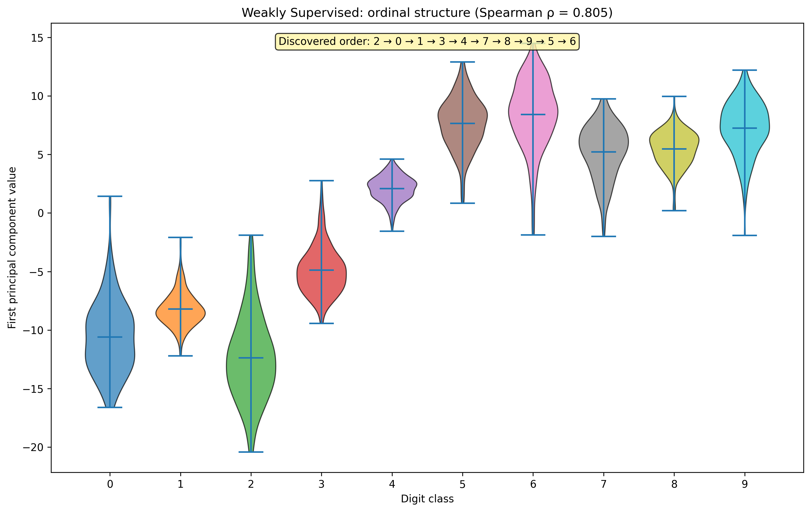
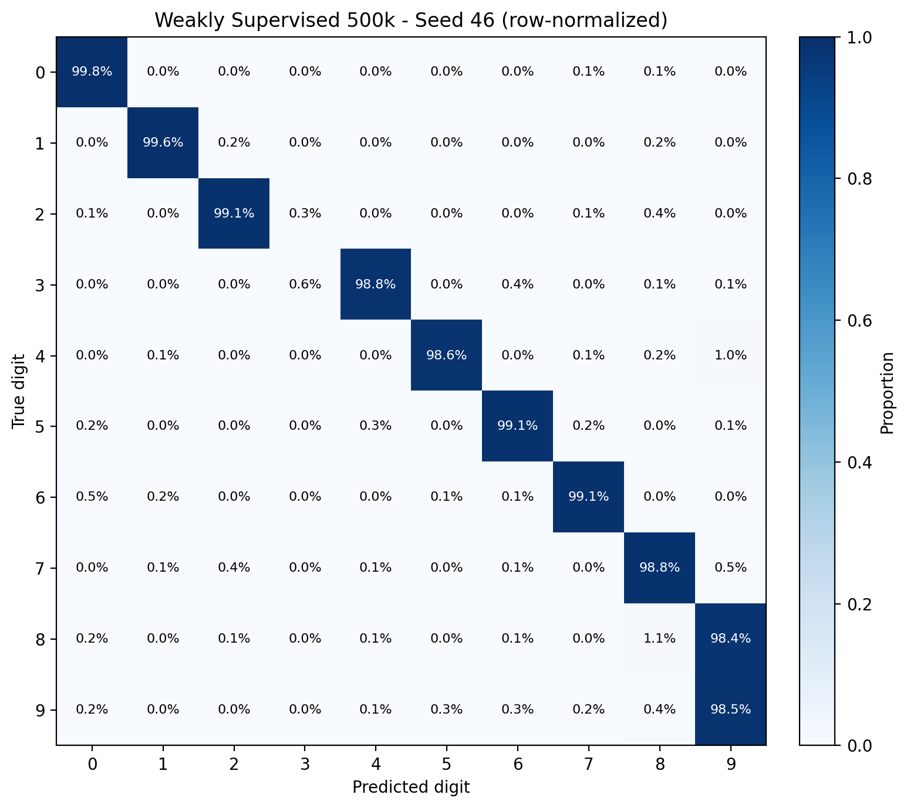

# seed 46

## 50k

- 关系测试准确率：**98.060%**
- 数字测试准确率：**32.17%**
- 最佳 epoch：5
- 错位（真实类→主预测类）：2→3, 3→4, 4→5, 5→6, 6→7, 7→8, 8→9
- Spearman ρ：0.6614
- Discovered order：2 → 3 → 1 → 0 → 8 → 4 → 7 → 9 → 5 → 6

文件：`metrics_50k.json`、`history_50k.csv`、`checkpoint_50k.pth`、`confusion_matrix_50k.csv`、`confusion_matrix_50k/`、`embedding_50k/`

## 500k

- 关系测试准确率：**98.305%**
- 数字测试准确率：**41.44%**
- 最佳 epoch：3
- 错位（真实类→主预测类）：3→4, 4→5, 5→6, 6→7, 7→8, 8→9
- Spearman ρ：0.8049
- Discovered order：2 → 0 → 1 → 3 → 4 → 7 → 8 → 9 → 5 → 6

文件：`metrics_500k.json`、`history_500k.csv`、`checkpoint_500k.pth`、`confusion_matrix_500k.csv`、`confusion_matrix_500k/`、`embedding_500k/`

## 图

