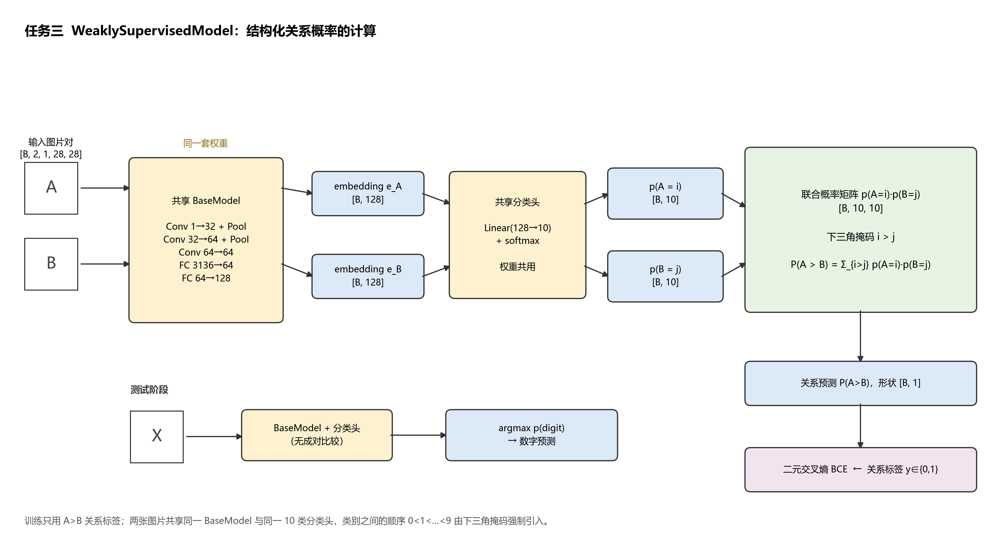
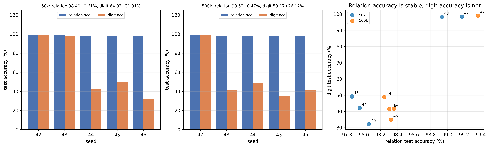
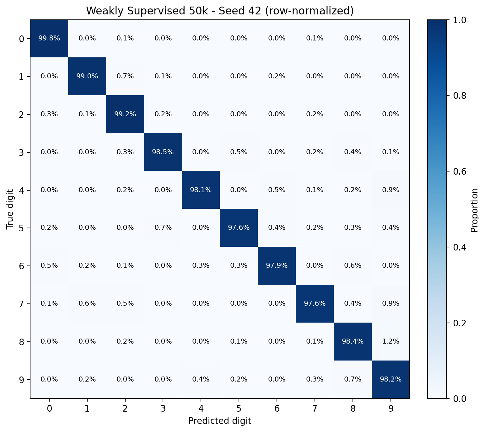
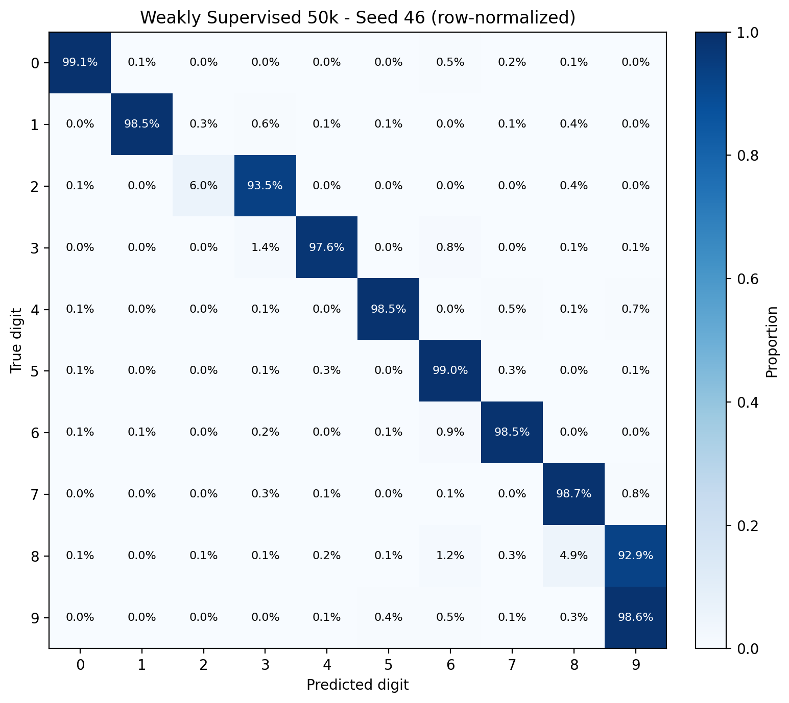
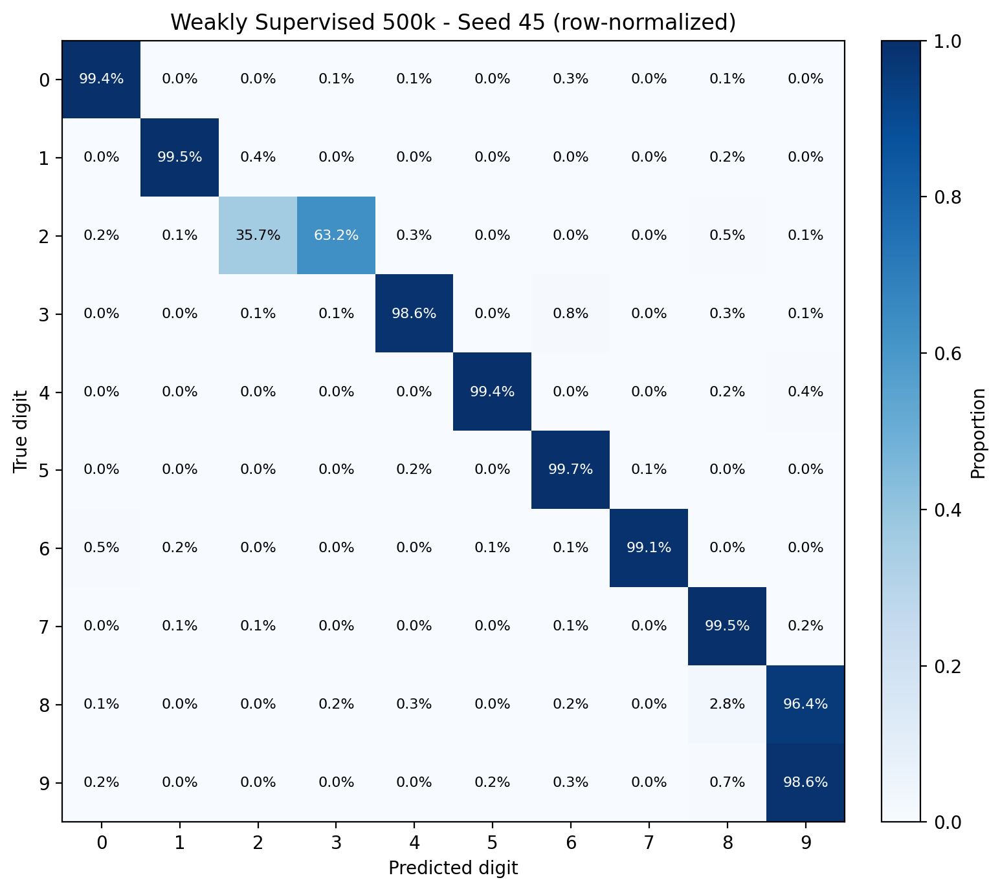
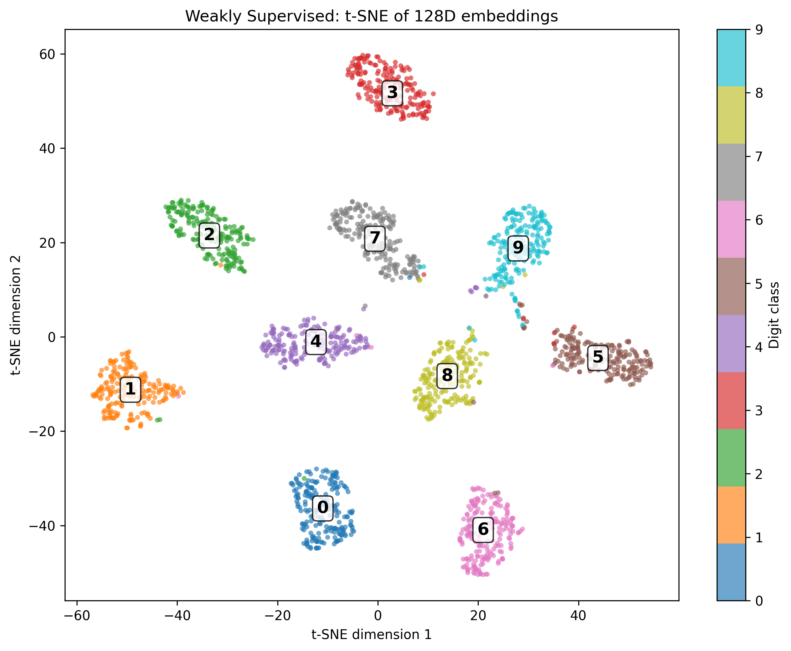
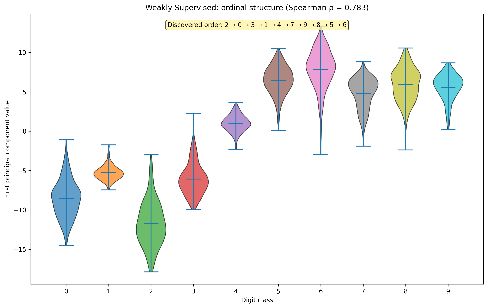

# 任务三：基础弱监督模型 `WeaklySupervisedModel`

> 实验环境：Windows 11 + RTX 4070 SUPER（12 GB），Python 3.12.7 venv，PyTorch 2.7.0+cu128 / CUDA 12.8
> 训练设置：Adam，lr=1e-3，weight_decay=1e-4，batch=128，epochs=5，seed = 42/43/44/45/46
> 关系数据：50k 与 500k 两组（val/test 固定各 20k 对，正类比例 ≈ 50%）

---

## 1. 模型结构与关系概率的计算



一对图片 `[B, 2, 1, 28, 28]` 拆成 A、B 两路，**共用同一个 `BaseModel`（同一套权重，不是两个 CNN）**，各自得到 128 维 embedding；两个 embedding 再进**同一个 `Linear(128→10)` 分类头**并做 softmax，得到 `p(A=i)`、`p(B=j)`。关系概率由 10×10 的联合分布加下三角掩码算出来：

$$P(A>B)=\sum_{i>j} p(A=i)\cdot p(B=j)$$

代码里这一步就是 `probs1.unsqueeze(2) * probs2.unsqueeze(1)` 得到 `[B,10,10]`，乘 `tril(..., diagonal=-1)` 掩码后对两维求和；结果 clamp 到 `(eps, 1-eps)` 再和 0/1 关系标签算 `BCELoss`。

测试阶段不使用成对比较：单张图片直接走 `BaseModel → 分类头 → argmax` 得到数字类别。**关键点：类别之间的顺序 `0<1<…<9` 是下三角掩码硬编码进去的，模型没有学到，是被规定好的。**

---

## 2. 五 seed 结果

### 2.1 汇总

| 关系数据量 | 关系测试准确率 | 数字测试准确率 |
|---|---|---|
| 50k | **98.40 ± 0.61 %** | **64.03 ± 31.91 %** |
| 500k | **98.52 ± 0.47 %** | **53.17 ± 26.12 %** |

（`training_results/weakly_supervised/*/summary.json`，五个 seed 的 mean ± std，ddof=1）

### 2.2 逐 seed

| seed | 50k 关系 | 50k 数字 | 500k 关系 | 500k 数字 |
|---|---|---|---|---|
| 42 | 99.18 | **98.45** | 99.37 | **99.07** |
| 43 | 98.94 | **98.26** | 98.36 | 41.62 |
| 44 | 97.95 | 42.04 | 98.25 | 48.75 |
| 45 | 97.86 | 49.25 | 98.33 | 34.95 |
| 46 | 98.06 | 32.17 | 98.31 | 41.44 |



一句话：**关系准确率被死死钉在 98% 附近（std < 0.7%），数字准确率却在 32%~99% 之间随机跳。** 而且 500k 的数据量并没有把数字准确率抬上去，反而 5 个 seed 里只有 1 个落在高准确率上（50k 是 2 个）。

---

## 3. 高关系准确率 ≠ 高分类准确率：错位到底错在哪

把每个 seed 的混淆矩阵按"真实类 → 占比最高的预测类"压缩成一行，问题立刻暴露：

| 实验 | seed | 数字准确率 | 真实类 → 主预测类 |
|---|---|---|---|
| 50k | 42 | 98.45 | 0→0 1→1 2→2 3→3 4→4 5→5 6→6 7→7 8→8 9→9 |
| 50k | 43 | 98.26 | 0→0 1→1 2→2 3→3 4→4 5→5 6→6 7→7 8→8 9→9 |
| 50k | 44 | 42.04 | 0→0 1→1 2→2 **3→4 4→5 5→6 6→7 7→8 8→9** 9→9 |
| 50k | 45 | 49.25 | 0→0 1→1 2→2 **3→4 4→5 5→6 6→7 7→8** 8→8 9→9 |
| 50k | 46 | 32.17 | 0→0 1→1 **2→3 3→4 4→5 5→6 6→7 7→8 8→9** 9→9 |
| 500k | 42 | 99.07 | 0→0 1→1 2→2 3→3 4→4 5→5 6→6 7→7 8→8 9→9 |
| 500k | 43 | 41.62 | 0→0 1→1 2→2 **3→4 4→5 5→6 6→7 7→8 8→9** 9→9 |
| 500k | 44 | 48.75 | 0→0 1→1 2→2 **3→4 4→5 5→6 6→7 7→8** 8→8 9→9 |
| 500k | 45 | 34.95 | 0→0 **2→3 3→4 4→5 5→6 6→7 7→8 8→9** 9→9 |
| 500k | 46 | 41.44 | 0→0 1→1 2→2 **3→4 4→5 5→6 6→7 7→8 8→9** 9→9 |

高准确率的 seed 是**恒等映射**；低准确率的 seed 全都是同一类错误：**把一段连续的类别整体往前（+1）挪了一个槽位，而两端的类（0、1、9）保持不变**。也就是分类头的 10 个槽位里有一个槽位是空的、另一个槽位被两个相邻类别共用 —— 一个**保序但非单射**的重标号。

### 为什么这种错位不会被关系损失惩罚

关系损失只关心 `P(A>B)`，而 `P(A>B)` 只依赖两个样本落在**哪个槽位**的先后关系，和槽位叫什么编号无关：

- 把标号做任意单调重排（如 `0,1,2,3,4,5,6,7,8,9 → 0,1,2,3,4,5,6,7,8,9` 与 `0,1,2,4,5,6,7,8,9,9`），所有 `i>j` 的联合概率项完全不变；
- 唯一被破坏的是**被合并的那一对相邻类别**：A、B 恰好是 `{d, d+1}` 时，模型给出 `P(A>B)≈0.5`，这一半全错。

用 MNIST 测试集类别分布算一下这对损失有多大：

| 被合并的相邻类 | 该关系对占全部对数 | 对应关系准确率损失 |
|---|---|---|
| {2,3} | 2.08 % | 1.04 % |
| {3,4} | 1.98 % | 0.99 % |
| {4,5} | 1.75 % | 0.88 % |
| {5,6} | 1.71 % | 0.85 % |
| {6,7} | 1.97 % | 0.98 % |
| {7,8} | 2.00 % | 1.00 % |
| {8,9} | 1.97 % | 0.98 % |

合并一对相邻类别只掉 **≈1 个百分点**的关系准确率，合并两对掉 ≈2 个百分点。实测正好是 97.9%~99.4% —— **和这套算术完全对得上**。这就解释了那个看起来很奇怪的现象：数字准确率从 99% 掉到 32%，而关系准确率只掉了 1.5%。

> 换句话说，任务三的损失函数是**欠定**的：数字分类准确率只在"恒等映射"这一个解上才高，而该解与无数个"错位映射"解在关系损失上几乎不可区分。优化器落到哪个解，取决于初始化和数据顺序（也就是 seed），属于随机事件。数据量增加只是让模型更快地拟合到某一个（可能是错的）解上，500k 的结果正说明了这一点。

### 混淆矩阵对比（最好 vs 最差）

| 50k seed 42（98.45%） | 50k seed 46（32.17%） |
|---|---|
|  |  |

| 500k seed 42（99.07%） | 500k seed 45（34.95%） |
|---|---|
|  |  |

左图是干净的对角线；右图的误判**不是零散混淆，而是整块平移** —— 50k seed 46 表现为 2→3、3→4、…、8→9 的连续错位，500k seed 45 是同一模式。这正符合 README 里问的"真实数字 3 被集中预测成 4"的情形。

---

## 4. Embedding 分析（`seed_42`，每类 200 张测试图）

| 实验 | Spearman ρ | Discovered order |
|---|---|---|
| 50k seed 42 | **0.821** | 2 → 1 → 0 → 3 → 4 → 7 → 6 → 8 → 9 → 5 |
| 500k seed 42 | **0.783** | 2 → 0 → 3 → 1 → 4 → 7 → 9 → 8 → 5 → 6 |





读图要点：

1. **t-SNE 里 10 个数字的簇分离得很干净，几乎没有混叠**，说明共享骨干网络学到的特征是完全可用的，问题不在特征质量。
2. **PCA 第一主成分上的类别均值接近单调递增**（ρ≈0.78~0.82），`Discovered order` 与 `0,1,2,…,9` 只差几处局部交换 —— 关系监督**确实**把顺序信息编码进了 embedding，这正是任务三想验证的事情。
3. 但 ρ<1、局部顺序有交换：第一主成分只是 128 维空间里的一个投影方向，簇在二维/一维投影上的位置本身带有噪声，绝对类别边界并没有被"钉住"。**embedding 的簇排列出了正确的序，但哪个簇对应哪个数字，仍然由分类头的偏置和初始化决定。**

补充：把其余 4 个 seed 的 embedding 也跑了一遍（`mission3/seed_*/embedding_*/`）。错位 seed 的 ρ 同样在 0.66~0.82（seed 46 50k：ρ=0.661、数字 32.17%；seed 44 500k：ρ=0.742、数字 48.75%），t-SNE 里 10 个簇同样分离清晰。所以 **ρ 和簇的清晰度都不能用来预测数字分类准确率**，它只反映"顺序学到了"，不反映"标号对上了"。

---

## 5. 结论

1. 结构化关系监督（`Σ_{i>j} p(A=i)p(B=j)`）确实在 embedding 空间里恢复出了数字的大小顺序（ρ ≈ 0.8），关系测试准确率稳定在 98.4%~98.5%。
2. 但数字分类准确率极不稳定（std ≈ 26~32 个百分点）：损失的等价类里包含大量"保序但标号错位"的解，这些解只损失 ≈1~2% 的关系准确率，却损失 50%~65% 的分类准确率。
3. 数据量不是解药。500k 相比 50k 只把关系准确率提高了 0.12 个百分点，却让 4/5 的 seed 落进了错位解（50k 是 3/5）。
4. 因此**任务三的方法上限接近全监督（seed 42 的 98.45%/99.07% 已经达到），但可靠性很差**。要缩小这个 gap 需要额外信息：任务四（Siamese，把关系判断交给可学习的 MLP 头，结构约束更弱）和任务五（每类 1/3 张绝对标签做锚点，直接消除标号置换自由度）。

---

## 6. 复现命令

```powershell
# 环境
python -m venv .venv
.\.venv\Scripts\Activate.ps1
python -m pip install torch==2.7.0 torchvision==0.22.0 --index-url https://download.pytorch.org/whl/cu128
python -m pip install -r requirements.txt -r requirements-visualization.txt

# 数据（50k + 500k 一起生成）
python -m data.mnist.download_MNIST --train-sizes 50k 500k

# 50k 五 seed
python -m src.training.train_weakly_supervised

# 500k 五 seed（配置见 configs/weakly_supervised_500k.json）
python -m src.training.train_weakly_supervised --config configs/weakly_supervised_500k.json

# embedding 分析
python -m src.visualization.embedding_analysis --model weakly_supervised `
  --checkpoint "training_results/weakly_supervised/<实验目录>/seed_42/best_weakly_supervised_model.pth" `
  --output-dir "figures/weakly_supervised_50k_seed42"

# 混淆矩阵（最好/最差 seed 各跑一次）
python -m src.visualization.confusion_matrix_analysis `
  --input "training_results/weakly_supervised/<实验目录>/seed_46/digit_confusion_matrix.csv" `
  --output-dir "figures/weakly_supervised_50k_seed46/confusion_matrix" `
  --title "Weakly Supervised 50k - Seed 46 (digit 32.17%)"

# 结构图与五 seed 汇总图（本项目新增的两个脚本）
python -m src.visualization.weakly_supervised_structure_figure
python -m src.visualization.weakly_supervised_seed_summary `
  --experiment "training_results/weakly_supervised/<50k 目录>=50k" `
  --experiment "training_results/weakly_supervised/<500k 目录>=500k" `
  --output figures/weakly_supervised_seed_summary.png
```

## 7. 本次产出清单

| 内容 | 路径 |
|---|---|
| 结构化关系概率计算图 | `figures/weakly_supervised_structure.png` |
| 五 seed 柱状图 + 关系/数字散点 | `figures/weakly_supervised_seed_summary.png` / `.json` |
| 训练结果（runs/summary/每 seed metrics、history、checkpoint、混淆矩阵 CSV） | `training_results/weakly_supervised/weakly_supervised_{50k,500k}_*/` |
| t-SNE / PCA 小提琴 / ρ / Discovered order | `figures/weakly_supervised_{50k,500k}_seed42/` |
| 最好/最差 seed 混淆矩阵 | `figures/weakly_supervised_50k_seed{42,46}/confusion_matrix/`、`figures/weakly_supervised_500k_seed{42,45}/confusion_matrix/` |
| 500k 配置文件 | `configs/weakly_supervised_500k.json` |
| 新增脚本 | `src/visualization/weakly_supervised_structure_figure.py`、`src/visualization/weakly_supervised_seed_summary.py` |
| 训练日志 | `run_50k.log`、`run_500k.log` |
| PPT（2 页） | `report/任务三_WeaklySupervisedModel.pptx` |

## 8. 留给任务五的统一对比表（任务三部分）

| 方法 | 关系数据 | 关系测试准确率 | 数字测试准确率 |
|---|---|---|---|
| 全监督基线（待跑） | — | — | — |
| 基础弱监督 50k | 50k | 98.40 ± 0.61 | 64.03 ± 31.91 |
| 基础弱监督 500k | 500k | 98.52 ± 0.47 | 53.17 ± 26.12 |
